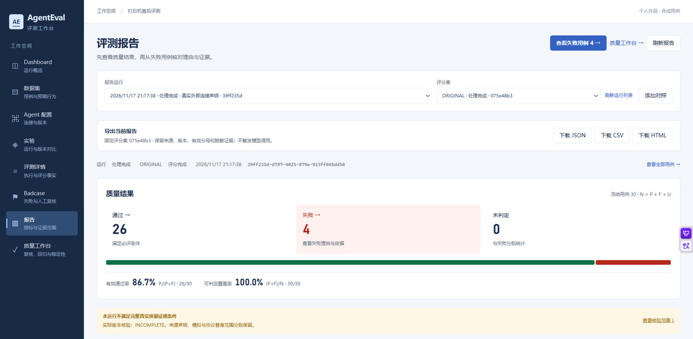
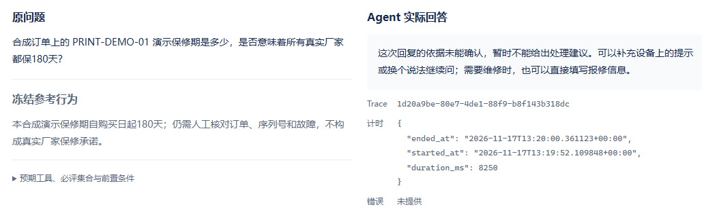
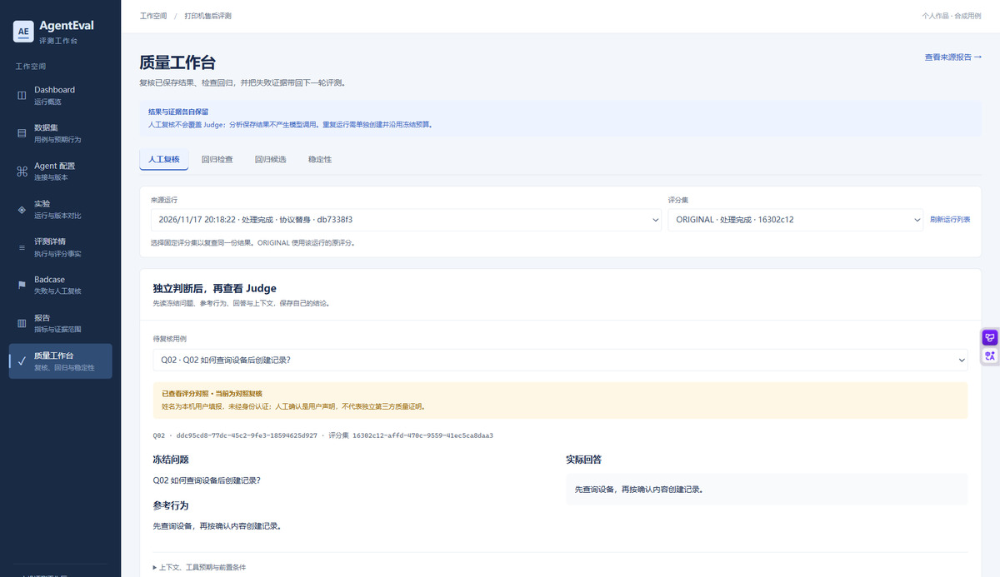

<div align="center">

<h1>AgentEval · AI Agent 评测工作台</h1>

<p><strong>用固定用例检查回答质量，用执行证据定位失败原因。</strong></p>

<p>从批量运行、规则与模型评分，到配置对比和 Badcase 分析的 Python / Vue 应用。</p>

<p>
  <a href="https://www.python.org/"></a>
  <a href="https://fastapi.tiangolo.com/"></a>
  <a href="https://vuejs.org/"></a>
  <a href="https://www.mysql.com/"></a>
  <a href="LICENSE"></a>
</p>

<p>
  <a href="#运行截图">运行截图</a> ·
  <a href="#功能">项目功能</a> ·
  <a href="#快速启动">快速启动</a> ·
  <a href="docs/architecture.md">架构说明</a> ·
  <a href="docs/evaluation.md">评测记录</a>
</p>

<p>作者：<a href="https://github.com/dashstar22">dashstar22</a></p>

</div>

---

## 项目介绍

AgentEval 是一个可在本机运行的 Agent 评测项目，将“准备测试集 → 批量执行 → 评分 → 比较配置 → 分析失败”连成完整流程。它适合在修改 Prompt、模型或工具流程后，检查原有能力是否退化，并追查具体用例的回答、工具结果和评分依据。

项目以 [纸序 · 打印机售后助手](https://github.com/dashstar22/printer-after-sales-assistant) 为接入案例，同时提供通用 HTTP 协议和 Mock 适配器。评测工作台与被测应用独立运行，历史输入和评分集单独保存。

这是一个使用 AI 辅助开发的个人学习与作品展示项目。仓库内的设备资料、问题和参考行为均为合成演示数据。

## 运行截图

以下图片于 **2026-11-18** 从当前界面重新截取。报告与 D11 详情读取 **2026-11-17 已保存的真实单配置补测**：30 题中 **26 通过、4 失败、0 未判定**。质量工作台读取同日合成夹具的已保存复核与一致性记录，不代表独立人工质量标注。本次没有新增 Agent 或 Judge 调用，也没有提交新的人工复核。

README 内展示页面重点预览，其中 D11 使用原问题、参考行为和实际回答的横向局部图；**点击预览图或下方文字链接，可查看从页头到页脚的完整长图**。三张完整图均核对了顶部、底部、表格所有列与末行；原始 JSON 仍保持折叠。完整图的范围、尺寸与文件哈希见[完整长图回执](docs/evidence/readme-fullpages-20261118.json)，D11 预览的裁切范围见[横向预览回执](docs/evidence/readme-d11-preview-20261118.json)。

<p align="center">
  <a href="docs/images/real-e2e-report-full-20261118.png"></a>
  <br />
  <sub>真实补测 · 26 / 4 / 0；成功模型元数据覆盖 29/30，真实 Judge 评分 30/30 · <a href="docs/images/real-e2e-report-full-20261118.png">查看完整报告长图（1800 × 3183）</a></sub>
</p>

<p align="center">
  <a href="docs/images/real-e2e-detail-full-20261118.png"></a>
  <br />
  <sub>D11 · 已检索到演示保修期仍未回答；原 Judge 分数为 2 / 1 / 3 / 2 · <a href="docs/images/real-e2e-detail-full-20261118.png">查看完整详情长图（1800 × 5423）</a></sub>
</p>

<p align="center">
  <a href="docs/images/quality-workbench-full-20261118.png"></a>
  <br />
  <sub>质量工作台 · 合成夹具的已保存复核与一致性，记录标注 AUTOMATED_HTTP_FIXTURE · <a href="docs/images/quality-workbench-full-20261118.png">查看完整工作台长图（1800 × 2536）</a></sub>
</p>

<details>
  <summary>查看历史 A/B 配置比较与无模型请求分支</summary>
  <p>以下图片对应 2026-11-16 历史 A/B，包含共同有效样本、指标差值与 H08 确定性追问，未替换为本轮单配置结果。</p>
  <p align="center"><a href="docs/images/report-full.png"></a></p>
  <p align="center"><a href="docs/images/no-model-branch-full.png"></a></p>
</details>

## 功能

当前版本包含 **Dashboard、数据集、Agent 配置、实验、评测详情、Badcase、报告、质量工作台**八个页面：

| 能力 | 已支持的操作 | 页面入口 |
|---|---|---|
| 运行概览 | 按来源查看最近一次运行的质量概览、近期运行与对应报告 | Dashboard |
| 数据集与用例 | 编辑问题、参考行为、必评项、预期工具、前置轮次、标签和来源许可，按需启停；运行时冻结输入 | 数据集 |
| Agent 接入 | 配置 Mock、通用 HTTP 或打印机售后适配器，查看凭证环境变量引用的解析状态，记录预期版本 | Agent 配置 |
| 后台批量运行 | 选择数据集和 Agent，以 JSON 设置 Judge、规则与执行预算；查询执行/评分进度和历史运行 | 实验 |
| 规则与 LLM Judge | 程序规则检查执行、工具与时限；Judge 评价正确性、相关性、任务完成度及适用时的依据充分性，保留理由和原始尝试 | 评测详情 |
| 失败证据追查 | 按通过、失败、未判定或自动原因筛选，从失败指标核对原问题、参考行为、实际回答、工具轨迹和上下文范围 | 报告 → 评测详情 |
| 配置与版本比较 | 核对数据、Judge 和规则口径，逐指标比较共同有效样本并进入左右用例；实际版本证据不足时保留未验证 | 实验 / 报告 |
| 独立重新评分 | 对已保存回答创建 RESCORE，选择 ORIGINAL 或 RESCORE 查看；原回答、评分与报告继续保留，Agent 不重复调用 | 实验 / 评测详情 |
| Badcase 整理 | 按自动分类或人工原因筛选，保存人工标签与备注；记录按评分集隔离 | Badcase / 评测详情 |
| 统计、图表与用量 | 分开统计 P/F/U、质量有效样本和工具技术结果，从图表下钻参与用例；Agent/Judge 用量分账，未知用量与费用保留为空 | 报告 |
| 结构化人工复核 | 专用盲审、人工结论与可选指标分、追加历史及 Judge 一致性分析；人工记录与原评分分别保存 | 质量工作台 → 人工复核 |
| 基线回归检查 | 固定基线和候选评分集，核对可比性、覆盖、新增失败和通过率下降；提供 CLI 与明确退出码 | 质量工作台 → 回归检查 |
| 工具行为断言 | 配置工具首次出现顺序和调用次数上限，保留实际事件证据；旧用例未配置时保持原口径 | 数据集 / 评测详情 |
| Badcase 待审回流 | 冻结来源用例、整理新参考行为，显式审批创建禁用回归用例；保留来源链接 | 质量工作台 → 回归候选 |
| 离线报告 | 下载当前固定评分集的 JSON、CSV 或自包含 HTML，保留脱敏证据和单独的人工复核历史 | 报告 |
| 重复执行与稳定性 | 按来源 ORIGINAL 冻结输入新增 2–5 次独立执行；分析 2–10 次不同运行的 P/F/U、翻转和指标波动 | 质量工作台 → 稳定性 |

典型流程：**数据集准备问题 → Agent 配置连接 → 实验冻结并启动 → 报告查看质量与失败 → 详情核对证据 → Badcase 记录原因 → 修改配置后创建新运行或对原回答重评**。同一执行的多个评分集可分别查看和比较。

预期工具按名称集合匹配，提供跳过检查、包含指定名称、名称集合完全一致三种口径，详见[评分说明](docs/evaluation.md#程序规则)。凭证引用、模型别名与候选版本标签均不会自动成为真实模型执行或版本变化的证明。
六项扩展的操作、迁移、预算及证据边界见[评测闭环扩展](docs/evaluation-extensions.md)。已有数据库升级时先运行 `alembic upgrade head`，再启动新版后端。

## 技术栈与结构

Python 3.12 / 3.13 · FastAPI · SQLAlchemy · Alembic · MySQL · HTTPX · Pydantic。前端使用 Vue 3、TypeScript、Vite、Element Plus 和 ECharts。

```text
Vue 工作台
    │ HTTP API
FastAPI 应用 ───────────────────────────── MySQL
    ├─ 数据集 / 配置 / 实验 ── 冻结输入与版本摘要
    ├─ 单进程后台执行器
    │    └─ Agent 适配器 → 保存回答 → 获取观测 → 规则 / Judge
    └─ 评分集 / 配置对比 / Badcase / 报告
```

后台使用数据库独占锁和唯一活动任务约束，当前按单进程、单活动批次运行；中断后标记状态，由使用者决定是否创建新运行。模块职责和取舍见 [架构说明](docs/architecture.md)。

## 快速启动

准备 **Python 3.12 或 3.13、uv、Node.js 20.19+（20.x）或 22.12+、MySQL 8.4**。使用仓库提供的隔离数据库脚本时还需要 Docker。首次启动的数据库创建、连接配置和等待就绪步骤见 [运行手册](docs/quickstart.md)。

```powershell
git clone https://github.com/dashstar22/agent-eval.git
cd agent-eval
uv sync --project backend --locked
```

按运行手册配置独立 MySQL，并在当前终端设置 `AGENTEVAL_DATABASE_URL` 后，启动后端：

```powershell
cd backend
uv run --locked alembic upgrade head
uv run --locked python -m agenteval.seed
uv run --locked uvicorn agenteval.main:app --host 127.0.0.1 --port 18080 --workers 1
```

在另一个终端，从仓库根目录启动前端：

```powershell
cd frontend
npm ci --ignore-scripts
npm run dev
```

打开 [本机工作台](http://127.0.0.1:15173)；后端交互式 API 文档为 [Swagger UI](http://127.0.0.1:18080/docs)。初始化会导入 30 条合成用例。新数据库的历史报告为空；截图使用已保存的真实评测结果与明确标注的合成界面验证数据。

**无需模型密钥**即可维护数据和配置、运行本地测试，并使用 Mock Agent 检查执行链路。Mock 不生成真实 AI 回答；没有有效 Judge 配置时，相关质量项会显示评分错误或未判定。

**真实评测**需要自行配置被测 HTTP 服务和 Judge 凭证，并会产生模型用量。打印机专用接入还依赖被测应用的认证、设备归属与观测接口；接入契约见 [Agent 接入协议](docs/integration.md)，配置与预算见 [运行手册](docs/quickstart.md)。工作台默认仅用于本机可信环境。

## 验证与评测

### 最新真实端到端补测（2026-11-17）

使用固定 30 题合成已见回归集，真实打印机 Agent 与真实 Judge 均配置为 `qwen-plus`，单配置完成一轮并保留首次结果：

| 核对项 | 结果 |
|---|---|
| Agent 执行成功 | 30/30，无执行超时或技术业务失败 |
| 质量通过 / 失败 / 未判定 | **26 / 4 / 0** |
| 有效通过率 / 可判定覆盖率 | **86.67% / 100%** |
| 成功模型响应元数据覆盖 | **29/30** |
| 真实 Judge 成功评分 | **30/30** |
| 实际版本核验 | **INCOMPLETE**，供应商不可变模型快照未知 |

H08 是合理的 `NO_MODEL_REQUEST` 确定性追问分支，质量通过，用量为 `NOT_REQUESTED`。四题质量失败保留为 D11、H01、H02、H04：D11 已检索到演示保修期仍未回答；其余三题转为报修信息追问，遗漏知识答案且未调用预期检索工具。

Agent 内部 CHAT 与 Judge 分别记录 122,324 和 108,065 token；Embedding、Rerank 用量仍有未知字段，费用为 `null`。这次是单次回归，数据已见且为合成资料，Agent 与 Judge 同源，未做独立人工盲审，不能据此宣称模型排名或效果提升。完整记录见[真实端到端补测报告](docs/real-e2e-20261117.md)及[逐题证据](docs/evidence/real-e2e-20261117.json)。

### 同日全量功能测试

| 检查 | 结果 | 范围 |
|---|---|---|
| 后端全量 pytest | **286 passed** | 本机存在原始资料包；常规测试使用本地数据库与协议替身 |
| 真实 MySQL 专项 | **11 passed** | 既有测试在独立数据库再次验证，与 286 项有重叠 |
| MySQL + HTTP 端到端 | **23/23 PASS** | Agent/Judge 为本地协议替身 |
| 浏览器功能与布局 | **36/36 PASS** | 实际浏览器交互与 DOM/宽度核对；截图视觉复核未验证 |
| 前端类型检查、构建与依赖许可 | **PASS** | 136 个包无未知许可；报告分块约 523 kB，保留构建提示 |

这轮功能测试与上面的真实模型补测分别执行、分别留证。范围与原始回执见[全量测试报告](docs/fulltest-20261117.md)及[结构化证据](docs/evidence/fulltest-20261117.json)。

### 历史 A/B 与公开源码验证

2026-11-16，在隔离打印机售后实例上使用同一份 30 题合成回归集，分别运行两种聊天模型配置，Judge 固定为 `qwen-plus`：

| 配置 | 执行成功 / 失败 | 质量通过 / 失败 / 未判定 | 有效通过率 | 成功模型元数据覆盖 |
|---|---:|---:|---:|---:|
| A · qwen-plus | 29 / 1 | 25 / 5 / 0 | 83.33% | 29/30 |
| B · qwen-flash | 23 / 7 | 10 / 20 / 0 | 33.33% | 18/30 |

两版均保存了 30 次成功 Judge 评分及理由。通过率由项目规则与评分阈值计算，属于这份已见合成回归集的结果。A/B 顺序执行且共用源端预算，B 存在调用上限、超时及模型不可用等情况，因此表中差异不能直接解释为两个模型的纯能力排名；整批实际版本变化仍未完全核实。

一个可追查的案例是 D04：工具已经命中相关资料，观测也记录了完整实际上下文，但最终回答仍称依据未确认。工作台保留原回答、工具结果和 Judge 低分，便于沿证据继续定位原因。

2026-11-17 公开源码副本验证：后端 **285 项测试通过、1 项因外部原始资料包缺失而跳过**，前端类型检查和构建通过。此前的工作台运行记录另有 50 项页面功能检查通过。上述后端测试是既有验证记录，未在本轮前端改版中重跑。数据来源、分母、评分规则、用量覆盖及结果局限见 [评测方法与记录](docs/evaluation.md)。

此前前端改版的类型检查、构建和依赖许可检查通过，完成 **41 项浏览器交互断言、17 项隔离 MySQL/HTTP 断言**，并以实际视口宽度核对 320px/390px 报告与详情无整页横向溢出。验证复用历史保存结果及隔离合成夹具，该轮 Agent 与 Judge 请求均为 **0**，不构成新的模型质量测试。报告分块仍有约 **523 kB** 的构建体积提示；完整范围和证据见 [前端改版与验证](docs/frontend-redesign.md)。

随后完成六项评测闭环扩展：最终后端 **412 通过、1 跳过**，隔离 MySQL / HTTP / CLI **29 项**及去重浏览器断言 **39 项**通过；四个质量页在实际 320px / 390px 视口下均无整页横向溢出。前端构建与 136 包许可检查通过，未增加依赖。历史 8 个 API 结果及 76 个证据文件复查未变。本轮使用合成事实和协议替身，没有新增真实模型调用或独立人工质量标注，截图与检查限制见[扩展验证回执](docs/evidence/evaluation-extensions-20261117.json)。

本地检查入口：

```powershell
cd backend
uv run --locked pytest
cd ../frontend
npm run build
```

常规后端测试使用本地数据库或协议替身，不请求外部模型。原始合成资料包的跨仓库比较在缺少资料时会跳过，因此公开源码副本曾为 285 通过、1 跳过，本机资料齐全时为 286 通过；两者不应混记为同一次结果。额外的 MySQL 专项检查需要单独配置独立测试库。

## 目录

```text
backend/       FastAPI 应用、数据库迁移与测试
frontend/      Vue 工作台与前端依赖锁
data/          合成用例、Judge 校准样例与来源许可
scripts/       隔离数据库、Judge 校准和结果复算工具
docs/          运行、架构、接入协议、评测与实际截图
```

## 联系与许可

欢迎通过 [Issues](https://github.com/dashstar22/agent-eval/issues) 反馈复现问题，或在 [GitHub](https://github.com/dashstar22) 交流 AI 应用与评测实践。

自有源码按 [MIT License](LICENSE) 开源。合成题目和演示资料使用各目录内的 CC0-1.0 声明；第三方依赖保留各自许可，见 [第三方来源与许可](docs/third-party-notices.md)。演示资料不构成真实设备维修指导。
