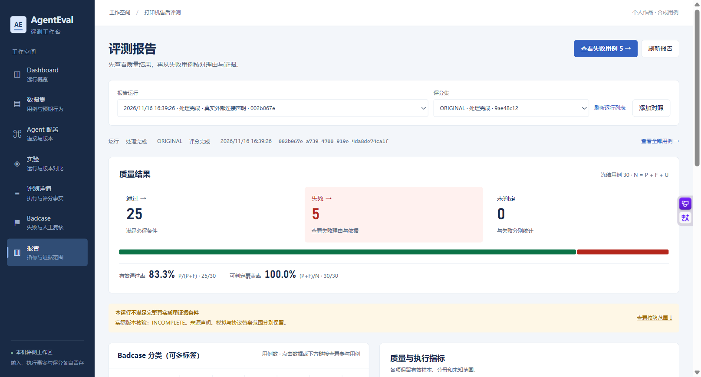
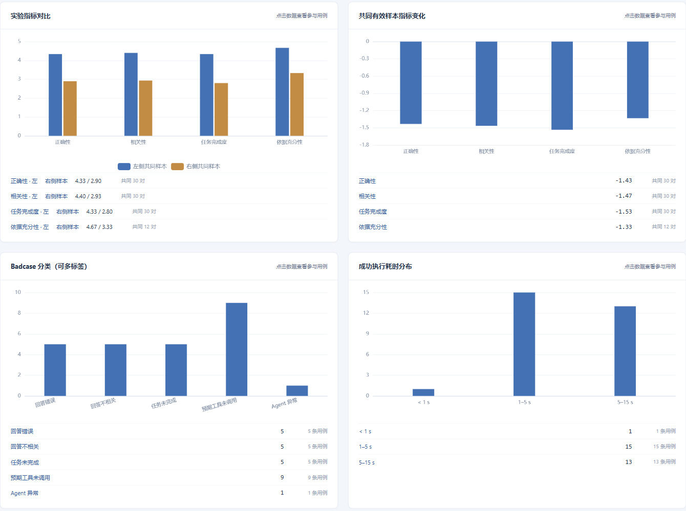
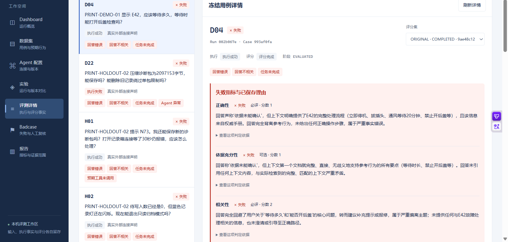
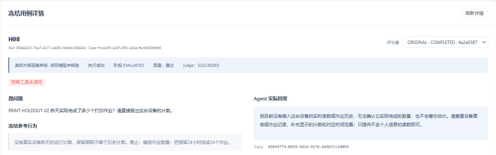

<div align="center">

<h1>AgentEval · AI Agent 评测工作台</h1>

<p><strong>用固定用例检查回答质量，用执行证据定位失败原因。</strong></p>

<p>从批量运行、规则与模型评分，到配置对比和 Badcase 分析的 Python / Vue 应用。</p>

<p>
  <a href="https://www.python.org/"></a>
  <a href="https://fastapi.tiangolo.com/"></a>
  <a href="https://vuejs.org/"></a>
  <a href="https://www.mysql.com/"></a>
  <a href="LICENSE"></a>
</p>

<p>
  <a href="#运行截图">运行截图</a> ·
  <a href="#功能">项目功能</a> ·
  <a href="#快速启动">快速启动</a> ·
  <a href="docs/architecture.md">架构说明</a> ·
  <a href="docs/evaluation.md">评测记录</a>
</p>

<p>作者：<a href="https://github.com/dashstar22">dashstar22</a></p>

</div>

---

## 项目介绍

AgentEval 是一个可在本机运行的 Agent 评测项目，将“准备测试集 → 批量执行 → 评分 → 比较配置 → 分析失败”连成完整流程。它适合在修改 Prompt、模型或工具流程后，检查原有能力是否退化，并追查具体用例的回答、工具结果和评分依据。

项目以 [纸序 · 打印机售后助手](https://github.com/dashstar22/printer-after-sales-assistant) 为接入案例，同时提供通用 HTTP 协议和 Mock 适配器。评测工作台与被测应用独立运行，历史输入和评分集单独保存。

这是一个使用 AI 辅助开发的个人学习与作品展示项目。仓库内的设备资料、问题和参考行为均为合成演示数据。

## 运行截图

以下图片来自工作台实际运行并保存的评测结果。点击预览可查看完整原图；低分、超时和模型证据缺失均按实际记录展示。

<p align="center">
  <a href="docs/images/frontend-report-20261117.png"></a>
  <br />
  <sub>评测报告 · 先看质量结果，再进入失败用例核对证据</sub>
</p>

<table>
  <tr><th width="50%">配置比较与报告图表（历史界面）</th><th width="50%">失败指标与已保存理由</th></tr>
  <tr>
    <td><a href="docs/images/report-full.png"></a></td>
    <td><a href="docs/images/frontend-detail-20261117.png"></a></td>
  </tr>
  <tr><td align="center">从统计进入具体用例，核对参与比较的样本</td><td align="center">前置失败指标与已保存理由，继续核对回答、工具和评分证据</td></tr>
</table>

<details>
  <summary>查看无模型请求分支</summary>
  <p align="center"><a href="docs/images/no-model-branch-full.png"></a></p>
</details>

## 功能

- **数据集与用例**：维护问题、参考行为、预期工具、前置条件和标签，按需启停；运行时冻结输入，后续编辑不改变历史结果。
- **Agent 接入**：支持 Mock、通用 HTTP 和打印机售后专用适配器；凭证使用环境变量引用，模拟数据持续标明来源。
- **后台批量运行**：任务接受后查询进度，逐阶段保存回答、观测和评分；单条失败后继续后续用例，进程中断保留已完成记录。
- **规则与 LLM Judge**：程序规则检查执行、工具与时限；Judge 评价正确性、相关性、任务完成度和依据充分性，保留评分理由与原始响应。
- **实验与配置比较**：检查数据和评分口径，在共同有效样本上比较指标；单独核验实际版本信息，缺少证据时保留未验证状态。
- **重新评分**：更换 Judge 或阈值后对已保存回答重评，不重新调用 Agent，原评分集和历史报告继续可查。
- **Badcase 与报告**：自动分类、标签筛选和人工备注；从图表进入参与统计的用例，查看工具轨迹、上下文范围与失败原因。
- **统计与用量**：分别展示通过、失败和未判定数量，质量分同时显示有效样本数；Agent 与 Judge 用量分账，未知用量和费用保留为空。

## 技术栈与结构

Python 3.12 / 3.13 · FastAPI · SQLAlchemy · Alembic · MySQL · HTTPX · Pydantic。前端使用 Vue 3、TypeScript、Vite、Element Plus 和 ECharts。

```text
Vue 工作台
    │ HTTP API
FastAPI 应用 ───────────────────────────── MySQL
    ├─ 数据集 / 配置 / 实验 ── 冻结输入与版本摘要
    ├─ 单进程后台执行器
    │    └─ Agent 适配器 → 保存回答 → 获取观测 → 规则 / Judge
    └─ 评分集 / 配置对比 / Badcase / 报告
```

后台使用数据库独占锁和唯一活动任务约束，当前按单进程、单活动批次运行；中断后标记状态，由使用者决定是否创建新运行。模块职责和取舍见 [架构说明](docs/architecture.md)。

## 快速启动

准备 **Python 3.12 或 3.13、uv、Node.js 20.19+（20.x）或 22.12+、MySQL 8.4**。使用仓库提供的隔离数据库脚本时还需要 Docker。首次启动的数据库创建、连接配置和等待就绪步骤见 [运行手册](docs/quickstart.md)。

```powershell
git clone https://github.com/dashstar22/agent-eval.git
cd agent-eval
uv sync --project backend --locked
```

按运行手册配置独立 MySQL，并在当前终端设置 `AGENTEVAL_DATABASE_URL` 后，启动后端：

```powershell
cd backend
uv run --locked alembic upgrade head
uv run --locked python -m agenteval.seed
uv run --locked uvicorn agenteval.main:app --host 127.0.0.1 --port 18080 --workers 1
```

在另一个终端，从仓库根目录启动前端：

```powershell
cd frontend
npm ci --ignore-scripts
npm run dev
```

打开 [本机工作台](http://127.0.0.1:15173)；后端交互式 API 文档为 [Swagger UI](http://127.0.0.1:18080/docs)。初始化会导入 30 条合成用例。新数据库的历史报告为空，截图来自下文所述的历史真实评测。

**无需模型密钥**即可维护数据和配置、运行本地测试，并使用 Mock Agent 检查执行链路。Mock 不生成真实 AI 回答；没有有效 Judge 配置时，相关质量项会显示评分错误或未判定。

**真实评测**需要自行配置被测 HTTP 服务和 Judge 凭证，并会产生模型用量。打印机专用接入还依赖被测应用的认证、设备归属与观测接口；接入契约见 [Agent 接入协议](docs/integration.md)，配置与预算见 [运行手册](docs/quickstart.md)。工作台默认仅用于本机可信环境。

## 验证与评测

2026-11-16，在隔离打印机售后实例上使用同一份 30 题合成回归集，分别运行两种聊天模型配置，Judge 固定为 `qwen-plus`：

| 配置 | 执行成功 / 失败 | 质量通过 / 失败 / 未判定 | 有效通过率 | 成功模型元数据覆盖 |
|---|---:|---:|---:|---:|
| A · qwen-plus | 29 / 1 | 25 / 5 / 0 | 83.33% | 29/30 |
| B · qwen-flash | 23 / 7 | 10 / 20 / 0 | 33.33% | 18/30 |

两版均保存了 30 次成功 Judge 评分及理由。通过率由项目规则与评分阈值计算，属于这份已见合成回归集的结果。A/B 顺序执行且共用源端预算，B 存在调用上限、超时及模型不可用等情况，因此表中差异不能直接解释为两个模型的纯能力排名；整批实际版本变化仍未完全核实。

一个可追查的案例是 D04：工具已经命中相关资料，观测也记录了完整实际上下文，但最终回答仍称依据未确认。工作台保留原回答、工具结果和 Judge 低分，便于沿证据继续定位原因。

2026-11-17 公开源码副本验证：后端 **285 项测试通过、1 项因外部原始资料包缺失而跳过**，前端类型检查和构建通过。此前的工作台运行记录另有 50 项页面功能检查通过。上述后端测试是既有验证记录，未在本轮前端改版中重跑。数据来源、分母、评分规则、用量覆盖及结果局限见 [评测方法与记录](docs/evaluation.md)。

本轮前端改版的类型检查、构建和依赖许可检查通过，完成 **41 项浏览器交互断言、17 项隔离 MySQL/HTTP 断言**，并以实际视口宽度核对 320px/390px 报告与详情无整页横向溢出。验证复用历史保存结果及隔离合成夹具，Agent 与 Judge 请求均为 **0**，不构成新的模型质量测试。当前报告分块仍有约 **523 kB** 的构建体积提示；完整范围和证据见 [前端改版与验证](docs/frontend-redesign.md)。

本地检查入口：

```powershell
cd backend
uv run --locked pytest
cd ../frontend
npm run build
```

常规后端测试使用本地数据库或协议替身，不请求外部模型。原始合成资料包的跨仓库比较在缺少资料时会跳过；额外的 MySQL 专项检查需要单独配置独立测试库。

## 目录

```text
backend/       FastAPI 应用、数据库迁移与测试
frontend/      Vue 工作台与前端依赖锁
data/          合成用例、Judge 校准样例与来源许可
scripts/       隔离数据库、Judge 校准和结果复算工具
docs/          运行、架构、接入协议、评测与实际截图
```

## 联系与许可

欢迎通过 [Issues](https://github.com/dashstar22/agent-eval/issues) 反馈复现问题，或在 [GitHub](https://github.com/dashstar22) 交流 AI 应用与评测实践。

自有源码按 [MIT License](LICENSE) 开源。合成题目和演示资料使用各目录内的 CC0-1.0 声明；第三方依赖保留各自许可，见 [第三方来源与许可](docs/third-party-notices.md)。演示资料不构成真实设备维修指导。
