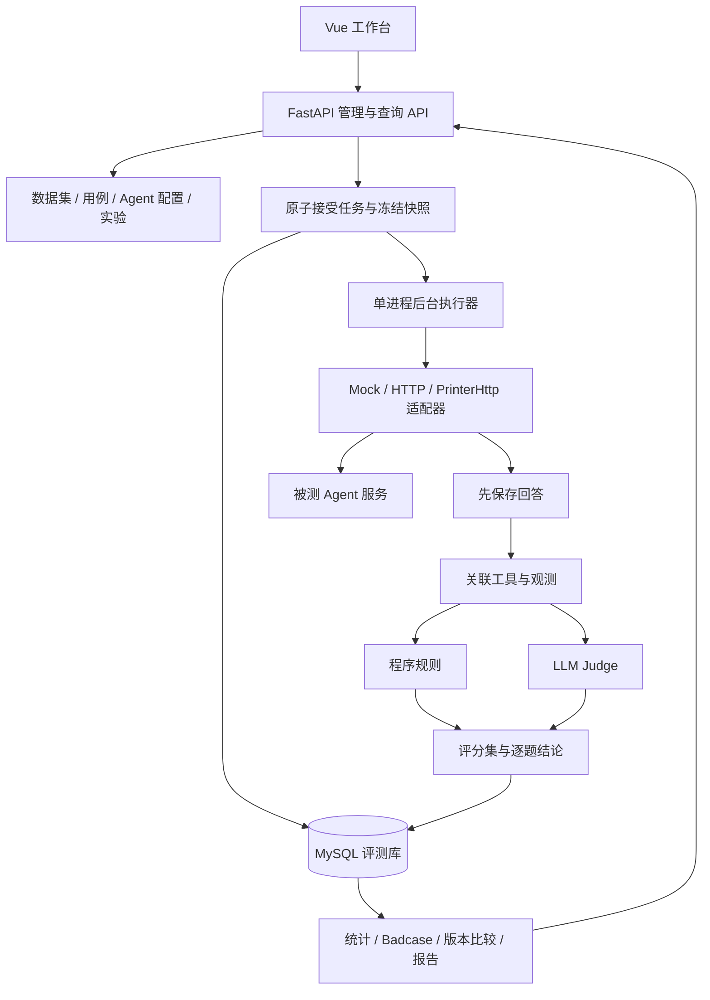

# 架构与数据流

AgentEval 将一次 Agent 执行拆成可追溯的输入、执行事实、评分和报告。核心目标是能从“这次为什么失败”回到同一道题的原始回答、工具结果、实际上下文和 Judge 理由，并在修改数据或评分配置后继续保留旧结论。

## 系统结构

后端通过 SQLAlchemy 和 Alembic 管理独立 MySQL schema。前端使用 Vue 3、TypeScript、Element Plus、Vue Router 和 ECharts，包含 Dashboard、数据集、Agent 配置、实验、评测详情、Badcase 和报告七个页面。

本机运行采用单进程和一个活动任务槽，没有引入 Redis、消息队列或分布式任务平台。访问方式见 [本机运行](quickstart.md)。

## 核心对象

| 对象 | 记录内容 | 历史关系 |
|---|---|---|
| Dataset / TestCase | 问题、参考行为、预期工具、必评项、来源与前置条件 | 当前可编辑输入；软删除保留历史关联 |
| AgentConfig | 适配器、地址、凭证引用、预期版本 | 停用后拒绝用于新运行，旧快照仍可读 |
| Experiment | 测试目的、数据集、Agent 配置与候选标签 | 一个实验可创建多个独立运行 |
| EvaluationRun | 一次冻结计划、预算、执行状态与输入摘要 | 不随当前数据或实验编辑而变化 |
| CaseRun | 某次运行中一道题的回答、观测、用量与状态 | 与该运行的冻结用例一一关联 |
| ScoreSet | ORIGINAL 或 RESCORE 的 Judge、规则快照和状态 | 同一执行可保留多个评分口径 |
| EvaluationScore / CaseEvaluation | 指标结果、理由与逐题总判定 | 按评分集保存，不覆盖旧结论 |

快照以规范化 JSON 计算 SHA-256，保存启用用例、配置、规则、Judge、预算和组件版本。历史保护由应用模型及数据库外键约束实现，数据库管理员仍有直接写入权限，项目不提供防篡改账本。

## 一次运行如何完成

1. **接受请求。** `POST /api/v1/runs` 或实验启动接口携带规范 UUID `request_id`。服务在短事务内锁定活动槽，校验来源、凭证引用和真实执行预算。
2. **冻结输入。** 保存运行、所有启用用例、配置与评分快照、ORIGINAL 评分集，然后提交事务。提交成功之后才注册后台任务，模型等待不占用这次数据库事务。
3. **执行 Agent。** 每题构建相应适配器，只把问题和显式前置轮次发给被测服务，参考答案及预期工具留在评测侧。
4. **分阶段保存。** 回答先提交；随后读取和关联工具与上下文，再保存各次 Judge 尝试、程序指标和最终结论。观测缺失不会擦掉已取得的回答。
5. **读取结果。** 进度、报告和 Badcase 从数据库已提交事实计算。批次 `COMPLETED` 表示处理结束，可以包含质量失败或执行失败。

同一个 `request_id` 和相同启动参数返回原运行，避免客户端超时重试时再次执行；同号不同参数返回冲突。不同请求遇到活动任务时返回 `RUNTIME_BUSY` 和活动任务身份，不追加隐式队列。每批最多接受 1000 条启用用例。

## 进程锁与中断

服务启动时用专属连接获取按 schema 名派生的 MySQL `GET_LOCK`，另用数据库活动槽控制并发提交。前者防止多个应用进程同时执行，后者保证接受任务的事务原子性。

持锁连接不会自动重连。每次新外部请求前及空闲周期检查所有权，丢锁后停止新调用并请求进程退出。新进程只有真正取得锁后，才将旧的孤立活动任务标为 `INTERRUPTED`；已提交的回答、尝试和评分保留，未执行题仍留在固定总数中。

该策略避免在外部调用结果未知时自动重放具有业务副作用的请求。需要再次执行时由使用者创建新运行。MySQL 命名锁限定于同一数据库服务，本方案不提供高可用调度、跨数据库互斥或任务无损续跑。

## 接入与观测

| 适配器 | 适用场景 | 记录来源 |
|---|---|---|
| Mock | 本地交互和确定性测试 | 始终保留 `MOCK`，不代表真实推理 |
| HTTP | 实现统一 JSON 契约的 Agent 服务 | 显式区分 `PROTOCOL_DOUBLE` 与 `REAL_EXTERNAL` |
| PrinterHttp | 兼容的打印机售后服务 | Session、CSRF、本人设备和轮次观测关联 |

PrinterHttp 每条独立用例使用新会话，先验证设备归属，再创建咨询并提交唯一轮次。收到回答后先保存，再用只读 GET 取得同一 trace 的观测。trace、咨询、轮次、设备与事件顺序都需要匹配；网络故障不会触发自动 Agent 重放。

工具未知 `null` 与已知空列表 `[]` 分开保存；模型选择的 `CHAT_TOOL` 与服务端 `SERVER_COORDINATOR` 分开统计。`ACTUAL_MODEL_CONTEXT` 表示采集自实际模型请求的上下文，`CITATION_SUBSET` 仅表示最终引用子集；范围和完整性各有独立字段。系统不会从最终答案猜测工具调用或未采集的上下文。完整请求与响应约定见 [接入协议](integration.md)。

## 评分、重评分与比较

程序规则与 LLM Judge 分开执行。规则检查执行、非空回答、工具和耗时；Judge 对正确性、相关性、任务完成度以及适用时的依据充分性评分。后端根据冻结阈值合并结论，不直接采信模型自行输出的 `passed`。统计分母、缺失处理与示例见 [评测说明](evaluation.md)。

RESCORE 从已保存的执行构建新评分集，只调用 Judge，不再调用 Agent；旧评分、理由和报告仍可按原评分集查看。Agent 用量作为原执行事实复用，不能将多个评分集报告中显示的 Agent 用量重复相加。运行与 RESCORE 共用活动槽。

比较两次运行时先核对数据、Judge 和规则指纹；条件不同时只并排展示。条件一致时按指标取共同有效题目计算均值和差值，空共同集合的差值为 `null`。候选标签与实际构建、Prompt、模型、知识版本分别核验，仅换标签不能证明实际版本变化。

## 代码入口

| 文件或目录 | 职责 |
|---|---|
| [`backend/src/agenteval/main.py`](../backend/src/agenteval/main.py) | 应用生命周期、管理 API 与统一错误响应 |
| [`schemas.py`](../backend/src/agenteval/schemas.py)、[`snapshots.py`](../backend/src/agenteval/snapshots.py) | 严格输入、预算与不可变快照 |
| [`runtime_control.py`](../backend/src/agenteval/runtime_control.py)、[`runtime_worker.py`](../backend/src/agenteval/runtime_worker.py) | 接受、锁、恢复与分阶段后台执行 |
| [`adapters/`](../backend/src/agenteval/adapters/) | Mock、HTTP、PrinterHttp 和响应归一化 |
| [`rules.py`](../backend/src/agenteval/rules.py)、[`judge.py`](../backend/src/agenteval/judge.py) | 程序规则与有界 Judge 调用 |
| [`evaluation_store.py`](../backend/src/agenteval/evaluation_store.py)、[`statistics.py`](../backend/src/agenteval/statistics.py) | 评分持久化和固定分母统计 |
| [`experiments.py`](../backend/src/agenteval/experiments.py)、[`rescore_worker.py`](../backend/src/agenteval/rescore_worker.py) | 实验历史与独立重评分 |
| [`comparisons.py`](../backend/src/agenteval/comparisons.py)、[`versions.py`](../backend/src/agenteval/versions.py) | 共同有效配对与实际版本核验 |
| [`workbench.py`](../backend/src/agenteval/workbench.py)、[`workbench_api.py`](../backend/src/agenteval/workbench_api.py) | 报告、Badcase、备注和 Dashboard |
| [`frontend/src/`](../frontend/src/) | 页面、路由、API 类型和图表交互 |

凭证在配置中仅保存环境变量引用，原始数据在写入和展示前脱敏。正常部署需要独立 MySQL，SQLite 只用于测试。源码测试与真实模型评测有各自的证据范围，不能互相替代。
