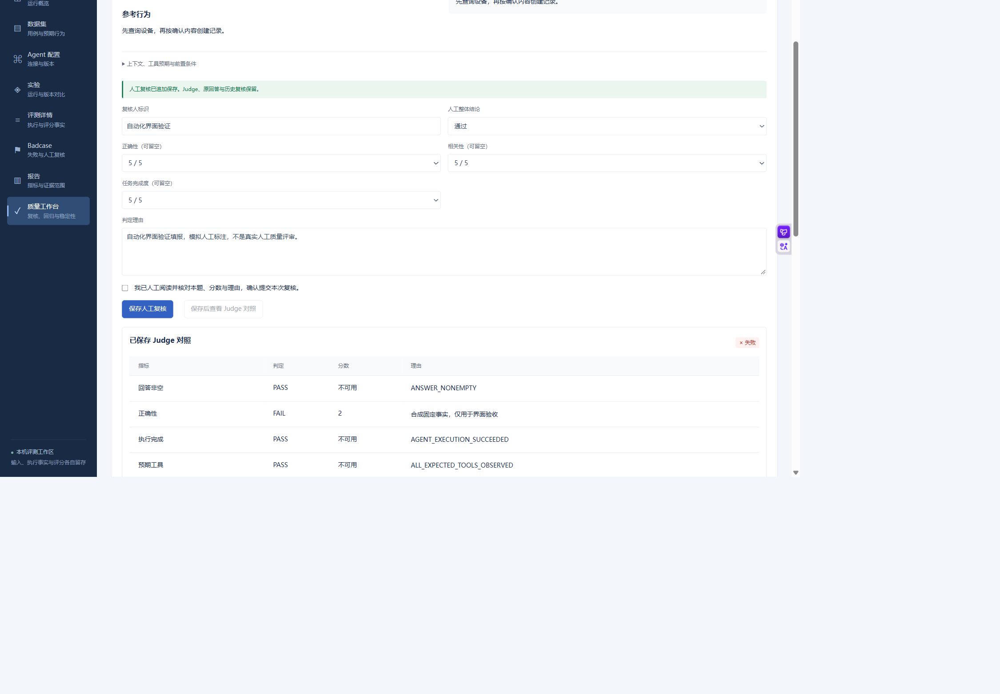

# 评测闭环扩展

这次扩展把人工复核、回归检查、工具行为断言、失败用例回流、报告导出和重复运行接入现有工作台。技术栈仍为 Vue / FastAPI / MySQL，后台继续使用单进程、单活动任务槽，没有增加 Redis、MQ 或第三方运行服务。

## 升级与入口

已有评测库先停止当前后端，在保存数据库备份后执行迁移，再启动后端。在迁移终端先设置原评测库的 `AGENTEVAL_DATABASE_URL`；可按[本机运行](quickstart.md#2-迁移初始化并启动后端)读取本机私有连接配置，不要把连接密码写入仓库。迁移只新增可空字段和扩展表，不重算旧评分，不改变历史冻结输入。

```powershell
cd backend
uv sync --locked
uv run --locked alembic upgrade head
uv run --locked uvicorn agenteval.main:app --host 127.0.0.1 --port 18080 --workers 1
```

前端启动方法不变：在另一个终端进入 `frontend`，运行 `npm ci --ignore-scripts` 和 `npm run dev`。全新环境的数据库配置见[本机运行](quickstart.md)。应用启动不会自动迁移数据库。

侧栏新增“质量工作台” `/quality`，包含人工复核、回归检查、回归候选和稳定性四个页签。报告页提供质量工作台及 JSON / CSV / HTML 下载入口；评测详情中的单题入口会带入运行、评分集和用例。工具断言在数据集用例编辑器配置。

## 人工复核与一致性

选择来源运行、评分集和用例，先看冻结问题、参考行为、实际回答与上下文。初次加载走专用盲审接口，`judge` 返回 `null`，不会先请求含 Judge 结论的完整详情。填写人工整体结论、可选的 1–5 整数分及理由，勾选确认后追加保存；保存后可主动查看 Judge 对照。可填指标以该用例的 `applicable_metrics` 为准，均可留空；缺少完整实际上下文时不能填写依据充分性分数，不适用指标提交返回 422。

人工记录与原 Judge、既有人工备注分别保存。再提交会追加一条记录，一致性分析对每题取最新记录。整体结论统计有效配对和一致率，各质量指标单独统计有效配对、精确一致率和平均绝对分差；漏评、未知项不补零，没有配对时为 `null`。分歧项保留用例标识，可从下方复核历史进入原始证据。

姓名属于本机用户声明，系统没有认证复核人的独立身份。主动读取历史一致性后，页面会提示已经查看评分对照。自动化测试填写的人工字段仅证明界面与持久化流程，不能作为独立人工质量复核证据。

## 基线回归检查与 CLI

在“回归检查”选择基线和候选运行，分别固定评分集。默认策略不允许新增失败、不允许共同有效配对上的通过率下降，且要求全部题目可判定。策略可显式调整，结果同时展示阈值、覆盖和具体用例。

| 结论 | 含义 |
|---|---|
| `PASS` | 已完成且满足可比性、覆盖与全部门禁条件 |
| `FAIL` | 比较条件充分，但至少一项策略阈值不满足 |
| `INCONCLUSIVE` | 尚未完成、口径不一致或有效覆盖不足，不能给出通过结论 |

通过率下降在共同有效题目上配对计算，并额外检查基线、候选及共同配对的覆盖。配置可比与实际版本核验分别展示，缺少版本证据不会被写成版本已核实。检查只分析保存结果，不调用 Agent 或 Judge。

从 `backend` 目录可运行同一分析入口，便于接入本机脚本或后续 CI：

```powershell
uv run --locked python -m agenteval.regression_cli --base-url http://127.0.0.1:18080 --baseline <基线运行UUID> --candidate <候选运行UUID> --format markdown --output regression-result.md
```

可选 `--baseline-score` 和 `--candidate-score` 固定评分集；`--format` 支持 `json`、`markdown`。退出码为 `0 PASS / 1 FAIL / 2 INCONCLUSIVE / 3 输入或请求错误`。输出文件使用独占创建，已有同名文件时拒绝覆盖。CLI 不负责创建运行或执行模型。

## 工具顺序与次数断言

用例可配置以下可选内容，并把对应指标加入必评项：

```json
{
  "tool_assertions": {
    "sequence": ["lookup", "write"],
    "max_calls": {"write": 1}
  },
  "required_metrics": ["tool_order", "tool_call_count"]
}
```

`sequence` 表示所列工具的**首次出现顺序**，每个名称都必须出现。示例要求第一次 `lookup` 在第一次 `write` 之前，允许其他工具和后续重复调用。`max_calls` 限定各工具最多调用次数，可为 0。次数和顺序只使用 profile 指定来源的 `TOOL` 事件。

只有配置后才生成 `tool_order`、`tool_call_count` 指标。轨迹未知、不完整或事件来源未知时为 `NA`，不能推测成功。证据包含规则配置、实际次数和事件标识、序号。空顺序、重复名称、空名称、负数、非整数，或把未配置的断言设成必评都会拒绝。

旧用例未配置时保持原指标口径；空断言不加入旧内容指纹。旧运行继续读取原冻结快照，不受当前编辑影响。

## Badcase 回到待审核用例

从失败、评测问题、既有失败标记，或最新结构化人工结论为 `FAIL` 的用例创建候选。填写目标数据集、新用例键、重新核对后的参考行为与回流理由。系统冻结原问题、工具预期、断言与前置条件，并记录来源运行、用例及评分集；不会把失败回答自动当作标准答案。

候选只有显式确认审批后才创建新用例，创建时为**禁用**，标记 `seen_regression=true`。在数据集检查内容后可单独启用。已见回归集不等于独立未见测试集。审批幂等，同名冲突返回 409，不覆盖现有用例。若最新人工结论已经改为 `PASS` 或 `UNDETERMINED`，更早的人工 `FAIL` 不能单独作为回流依据。

## 报告导出

报告页在当前运行和评分集下下载 JSON、CSV 或 HTML。导出保留原评测结论和脱敏证据，人工备注、结构化复核历史单独保存，不以人工结论替代 Judge。

- JSON 适合进一步处理，保留冻结配置、来源、分母及证据。
- CSV 每题一行，对可能被表格软件解释为公式的内容加防护。
- HTML 为自包含离线报告，对用户文本转义，不加载外部脚本。

下载、读取、门禁和稳定性分析都不产生模型调用，也不写回原运行记录。

## 重复运行与稳定性

在“稳定性”选择一个已完成来源运行，创建 2–5 次新执行，不包含来源本身。每轮复制来源 ORIGINAL 的完整冻结输入并建立独立运行和 ORIGINAL 评分集，顺序执行；当前数据集即使已经编辑，也不替换来源快照。界面所选 RESCORE 不会替换来源原配置，原人工备注和复核不会复制成新运行的标注。来源 Agent 配置停用或删除后拒绝新建批次。

提交前展示每轮预算与次数乘积。来源使用真实 Agent 或 Judge 时必须显式确认，且来源必须有明确的每轮总调用和总时限预算。平台调用上限不等于供应商内部调用数、Token 数或最终费用。重复运行会重新执行 Agent 和 Judge，与只重新评分的 RESCORE 不同。

批次与原有运行、重评分共用唯一活动槽；不会隐式并发或自动扩大预算。成员运行未正常完成时停止后续成员。请求号防止重试产生重复批次，同号不同参数返回 409。进程退出后保留完成记录，剩余成员标记中断，不自动重放或续跑。

可把批次加入稳定性分析，也可以选择 2–10 个不同实际运行。分析核对冻结数据、Agent、所选 Judge / 规则、预算和组件版本。条件一致才给出合并统计；不一致时保留逐次事实和限制，合并值为 `null`。同一执行的多个 RESCORE 不能伪装成多次执行。

每题展示通过 / 失败 / 未判定轨迹及已知结论翻转；指标展示有效观测数、均值、标准差和范围。未知值不补零。协议替身测试只验证统计与执行链路，不证明真实模型的稳定性。

## 实施与验证记录

API 和关键语义见[共同契约](evaluation-extensions-contract.md)，开源实现和许可调研见[调研记录](evaluation-extensions-research.md)。本轮最终测试、隔离 MySQL / HTTP、浏览器和历史保护结果统一记录于[验证回执](evidence/evaluation-extensions-20261117.json)。该回执区分工程功能验证与真实质量评测；本轮没有新增真实 Agent / Judge 质量测试。

最终后端 412 通过、1 项外部资料包检查跳过；MySQL / HTTP / CLI 29 项、去重浏览器断言 39 项通过。四个质量页分别核对了实际 320px 和 390px 视口，8 组均无整页横向溢出。构建及 136 包许可检查通过，没有新增依赖。原有 8 个历史 API 结果和 76 个证据文件复查未变。

下图是自动化填报后的实际人工复核界面，仅证明界面与保存流程；不是真实人工标注。该截图已查看，其他结果截图因浏览器捕获超时未取得，所以不宣称所有结果态完成像素审查。报告分块仍保留约 523 kB 的构建体积提示。


