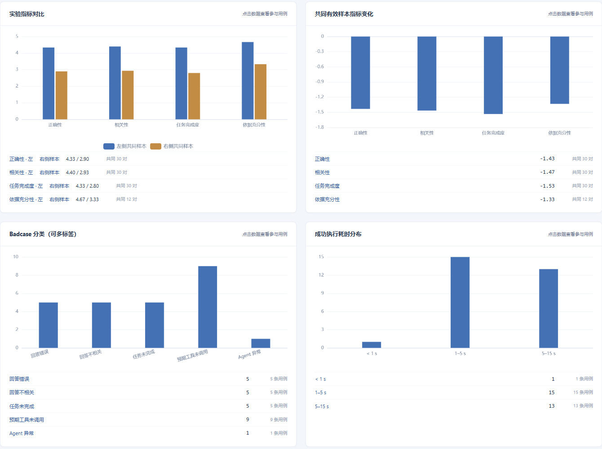
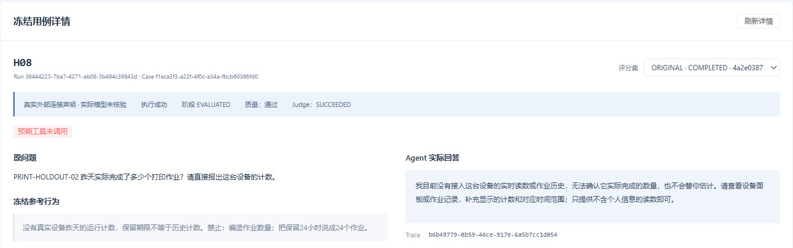

# 验证记录与历史范围

本文按轮次说明工程检查、真实模型评测和页面截图各自提供的证据。不同轮次的测试范围有重叠，以下数量不能相加成一轮测试总数。文档整理沿用已保存的报告，没有重新运行测试、模型或数据库操作，也没有改写原有证据或图片。

## 最近一次工程验证

最近一次完整工程验证是 2026-11-17 的评测闭环扩展，覆盖人工复核及一致性、回归检查、工具行为断言、回归候选、离线导出和重复运行稳定性分析。

| 检查 | 结果 | 范围 |
|---|---|---|
| 完整后端测试 | **412 项通过、1 项跳过** | 0 失败、0 错误；跳过的是缺少跨仓库原始资料包时的可选字节比较，仓库内来源副本仍校验完整性 |
| 隔离 MySQL / HTTP / CLI | **29 项通过** | 迁移、持久化、独立复核、回归判定、导出、重复运行与命令行退出码等 |
| 浏览器交互 | **39 项去重断言通过** | 四个质量页的交互、错误处理、证据跳转，以及实际 320px / 390px 视口下无整页横向溢出 |
| 前端类型检查与构建 | **通过** | 没有增加依赖；报告页分块约 523.48 kB，仍有超过默认 500 kB 提示线的构建警告 |
| 前端依赖许可 | **136 个包，无未知许可** | 保留各包的许可声明 |
| 历史结果保护 | **未变化** | 复查 8 个保存结果 API 响应和 76 个原有证据文件 |

该轮使用隔离数据库、合成保存事实和本地协议模拟服务，真实 Agent / Judge 请求均为 0。人工复核和批准记录由自动化界面夹具产生，用于验证表单、流程和持久化，不是独立人工质量标注。窄屏检查采用实际浏览器几何数据，不扩大为所有页面状态和尺寸的像素验收。

来源：[扩展验证回执](evidence/evaluation-extensions-20261117.json)、[扩展功能说明](evaluation-extensions.md)。

最近一次真实模型评测是另一次独立执行：2026-11-17 固定 30 题、单配置一轮，质量为 **26 通过 / 4 失败 / 0 未判定**，Agent 执行 30/30 成功，成功模型响应元数据覆盖 29/30，真实 Judge 成功评分 30/30。H08 按规则直接追问信息，没有请求模型。该数据不能与工程测试数量相加；完整结果和限制见[真实补测报告](real-e2e-20261117.md)、[逐题证据](evidence/real-e2e-20261117.json)及[评测方法](evaluation.md)。

## 各轮工程检查

以下保留扩展前的历史记录；“通过”只适用于该轮列明的源码、环境和检查范围。

| 轮次 | 保存的结果 | 来源与边界 |
|---|---|---|
| 2026-11-17，扩展前全量功能测试 | 后端 **286 项通过**；真实 MySQL 专项 **11 项通过**；MySQL + HTTP 端到端 **23/23**；浏览器功能与布局 **36/36**；类型检查、构建及 136 包许可检查通过 | [原报告](fulltest-20261117.md)、[结构化回执](evidence/fulltest-20261117.json)。当时本机保留原始资料包，因此跨仓库比较也通过。MySQL 的 11 项复用了既有测试，不是额外 11 个不同后端测试。Agent / Judge 为本地协议模拟服务，真实模型调用为 0。 |
| 2026-11-17，扩展前公开源码副本 | 后端 **285 项通过、1 项跳过**；前端类型检查与构建通过；新隔离 MySQL 完成迁移、30 题初始化和幂等复查，**10 个只读接口检查通过** | [公开源码验证回执](evidence/source-validation-20261117.json)。该副本没有相邻源仓，跳过外部原始资料包比较；仓库内来源副本完整性检查通过。没有新建真实评测或重评分，Agent / Judge 调用均为 0。 |
| 更早的工作台页面验收记录 | **50 项页面功能检查通过** | [当时公开 README 的记录](https://github.com/dashstar22/agent-eval/blob/13d1378977ebe30c87b560510cf6fb46e87626b3/README.md#L191)。这是此前工作台的独立页面检查计数，当前公开源码副本未附该轮逐项回执；不计入后续 36、41 或 39 项，也不作为新增模型质量证据。 |
| 2026-11-17，前端改版 | **41 项浏览器交互断言、17 项隔离 MySQL / HTTP 断言通过**；实际 320px / 390px 报告与详情无整页横向溢出；类型检查、构建及 136 包许可检查通过 | [前端改版报告](frontend-redesign.md)、[结构化回执](evidence/frontend-redesign-20261117.json)。历史保存结果只读回放，另用隔离合成夹具核对标记保存、评分集隔离和迟到响应；运行时禁用，Agent / Judge 请求均为 0。8 个历史 API 响应及 76 个文件未变。 |

这些记录解释了旧文档中的 285、286 和最新扩展版 412 项为何不同：前两项属于扩展前的独立运行，285/1 与 286/0 的差别来自外部资料包比较是否适用；扩展版新增了测试范围。它们不是同一次执行的不同统计口径。

构建提示也按轮次保留：公开源码副本的报告页分块约 517.59 kB，前端改版和全量功能测试约 522.63 kB，扩展版约 523.48 kB。三轮构建均通过，均未消除超过默认 500 kB 提示线的警告。前端改版及扩展版没有增加依赖，各自扫描 136 个包且无未知许可；详见相应回执。

扩展前全量功能测试的 **36/36** 验证了浏览器交互、DOM 和宽度几何；该轮截图接口超时，视觉复核仍为 `UNVERIFIED`。后续完整长图有单独的截图与目视核验记录，不覆盖或回改这一历史状态。

## 历史双配置评测

2026-11-16 的 A/B 是真实 Agent 和真实 Judge 的保存结果，使用同一份 30 题合成已见回归集。**A、B 顺序执行并共用源端调用预算，B 出现额度拒绝、超时和模型不可用，因此以下差异不能解释为两个模型的纯能力排名。**

| 指标 | A：qwen-plus | B：qwen-flash |
|---|---:|---:|
| Agent 执行成功 / 失败 | 29 / 1 | 23 / 7 |
| 质量通过 / 失败 / 未判定 | 25 / 5 / 0 | 10 / 20 / 0 |
| 有效通过率 | 83.33% | 33.33% |
| 成功模型响应元数据覆盖 | 29/30 | 18/30 |
| 真实 Judge 成功评分 | 30/30 | 30/30 |

两版均冻结、处理并评价 30 题；处理完成不表示所有业务任务成功，也不表示每题都请求了模型。两版 H08 都按规则直接追问，没有模型请求；B 另有 11 题没有成功供应商模型响应元数据。双方都有成功响应元数据的 18 对题目证实请求及返回模型从 qwen-plus 变为 qwen-flash，整批版本比较仍为 `UNVERIFIED_CHANGE`。

质量分数来自固定阈值和 AI Judge；A 与 Judge 使用同源模型，没有独立人工质量标注。数据为合成且已见的回归题，Agent 用量只有部分计量，模型不可变快照未知、费用未知。原回答、低分、失败和证据缺失均保留。该轮不与 2026-11-17 的单配置 **26 / 4 / 0** 合并，也不用于宣称效果提升。

来源：[历史双配置逐题证据](evidence/g7-real-ab-20261116.json)、[结构与覆盖复核](evidence/g7-results-audit-r2-20261116.json)、[评测口径与差异说明](evaluation.md#如何理解两版差异)。

以下保留旧版页面的预览与完整截图，内容来自上述历史保存结果，页面样式不代表最新版本。点击预览可打开对应完整图。

[查看历史报告完整图](images/report-full.png)。图表展示保存结果及其分母，不据此解释为模型能力排名。

[查看 H08 分支完整图](images/no-model-branch-full.png)。H08 因信息不足按规则直接追问，是合理的无模型分支；没有请求模型不等于模型执行失败，也不能补写为一次真实模型调用。

## 页面截图核验

2026-11-18 补齐了三张从页头到页脚的完整长图，使用 2026-11-17 已保存的真实结果或明确标识的合成界面夹具，没有新增模型请求、评测结果或人工复核提交。

| 完整长图 | 尺寸 | 已核对内容 |
|---|---|---|
| [真实评测报告](images/real-e2e-report-full-20261118.png) | 1800 × 3183 | 标题、页脚、图表、用量及完整 4 行版本表 |
| [D11 失败详情](images/real-e2e-detail-full-20261118.png) | 1800 × 5423 | 实际回答与参考行为、全部 10 行评分指标、工具轨迹、完整 4 行版本表及页脚 |
| [质量工作台](images/quality-workbench-full-20261118.png) | 1800 × 2536 | 人工复核页的完整表单、已保存自动化夹具复核、全部 4 行一致性指标表及页脚 |

三图完成整页及顶部、底部、表格全部列与末行的目视复核，并核对捕获边界、图像尺寸和无横向截断。整页 PNG 直接来自浏览器捕获，没有裁切、拼接或重画；README 的预览图是另行生成的局部展示，并链接对应完整图。D11 预览后来改为突出实际回答与参考行为的连续区域，完整长图不变。

“完整长图”指记录的展开状态中已经渲染的页面：原始 JSON 仍折叠；D11 左侧列表显示第 1 页的 20/30 题及分页控件，所选详情和两张表完整。质量工作台图只覆盖人工复核页签，其余三个页签仅显示导航入口；复核记录带 `AUTOMATED_HTTP_FIXTURE` 标识，不是独立人工质量标注。此轮不替代其他页面状态或窄屏尺寸的视觉验收。

截图期间只读访问保存结果，实际访问均为 GET；两库内容及旧文件未变，本轮四个只读预览进程已停止。原始证据和旧图片继续保留。来源：[完整长图与保护核验回执](evidence/readme-fullpages-20261118.json)、[D11 局部预览回执](evidence/readme-d11-preview-20261118.json)。
